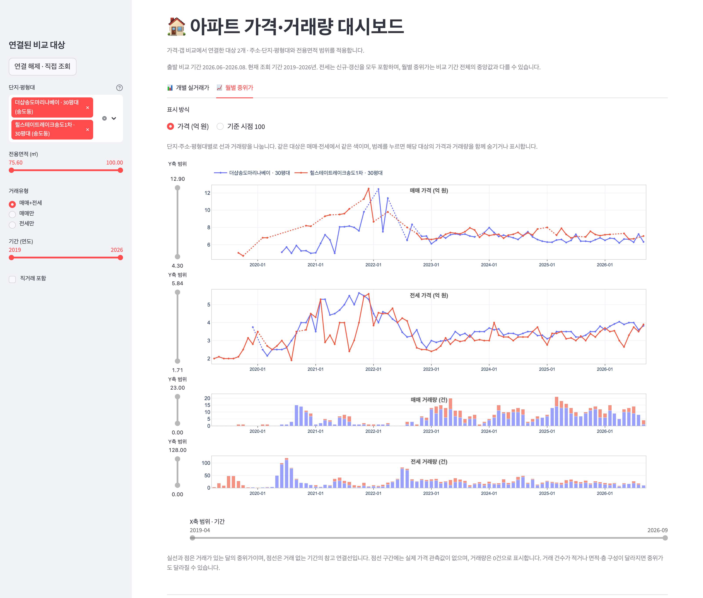

# 감을 확신으로 바꾸는 AI 부동산 투자

**바이브 코딩으로 만드는 나만의 부동산 분석 도구**

이 저장소는 책의 실습 프롬프트와 참고용 완성 코드를 제공합니다. 책을 따라 AI와 대화하며 관심단지 추적, 수익률 비교, 지역·단지 대시보드를 만들 때 사용합니다. 책 본문 전체와 AI 답변 예시는 포함하지 않습니다.

**[프롬프트 전체 목차](prompts/README.md)** · **[부록 1: 차트 검수](prompts/appendix/01_visualization_principles.md)** · **[부록 2: 후속 요청](prompts/appendix/02_practice_reference.md)** · **[부록 3: 프롬프트 응용](prompts/appendix/03_prompt_adaptation.md)**

## 직접 만들고 실행할 수 있는 분석 화면

[](projects/chapter09_price_volume/)

**가격의 변화와 거래량을 한 화면에서 확인합니다.** 7장에서 단지별 가격·갭을 비교하고, 선택한 단지를 9장으로 연결해 상세 조회할 수 있습니다. [7장 비교 대시보드](projects/chapter07_price_gap_table/) · [9장 실행 안내](projects/chapter09_price_volume/) · [4~9장 결과 화면 보기](#책의-목차와-실습-자료)

> 책 원고에 수록된 실제 데이터 실행 화면입니다. 장마다 조회 지역·기간이 다르며, 현재 시점의 시장 현황을 나타내는 실시간 화면은 아닙니다. [화면별 조회 조건과 출처](assets/screenshots/README.md)를 확인하세요.

## 처음 오셨다면

| 하려는 일 | 시작할 곳 |
| --- | --- |
| 책을 따라 직접 도구 만들기 | 아래 장별 프롬프트에서 해당 절의 요청을 복사합니다. 프롬프트만 볼 때는 저장소를 내려받을 필요가 없습니다. |
| 만든 도구를 다시 사용하거나 결과 점검하기 | [부록 2의 후속 요청](prompts/appendix/02_practice_reference.md)을 자신의 대상·기간에 맞춰 사용합니다. |
| 차트를 잘못 해석할 위험 점검하기 | [부록 1의 차트 검수 요청](prompts/appendix/01_visualization_principles.md)에 차트나 집계 결과를 함께 전달합니다. |
| 참고용 완성 코드를 내려받아 실행하기 | 아래 「참고 코드 실행 준비」와 [프로젝트 안내](projects/README.md)를 따릅니다. |

### 프롬프트 사용 순서

1. 책의 해당 장·절에서 필요한 자료와 준비 사항을 확인합니다.
2. 프롬프트 파일에서 지금 수행할 요청의 `text` 코드 블록을 복사합니다.
3. 자신의 실습 프로젝트를 연 클로드 코드에 붙여넣습니다. 파일 첨부가 필요한 요청에는 해당 자료를 함께 전달합니다.
4. AI가 확인한 데이터·조건·결과가 요청과 일치하는지 확인한 뒤 다음 단계로 넘어갑니다.

한 파일에는 구현, 검증, 오류 해결과 선택적인 수정 요청이 함께 들어 있습니다. 모든 블록을 한꺼번에 실행하지 않습니다. 짧고 모호한 요청은 비교용 예시이며, 처음 도구를 만들 때는 해당 절의 전체 구현 문안을 사용합니다. 대화형 사례의 후속 질문은 앞선 대화와 자료가 있어야 합니다.

## 자료의 기준과 제공 범위

2026-10-31 기준으로 1장부터 부록 3까지 프롬프트를 대조했습니다. 2~9장과 부록의 요청 **218개를 26개 파일**에 담았으며, 1장은 독립된 실습 프롬프트가 없습니다.

프롬프트는 현재 원고를 기준으로 갱신했습니다. 참고 코드는 현재 장 번호와 같은 `chapter04`~`chapter09` 경로로 갱신했습니다. 기존 `partXX` 실행 명령은 연결용 진입점으로 유지합니다. 모든 프롬프트를 각각 AI에 다시 실행한 것은 아니며, 코드의 검증 범위는 [검증 기록](VALIDATION.md)에 명시합니다. 책을 따라 만든 결과물은 파일명이나 코드 구조보다 요청한 기능과 검증 결과를 기준으로 확인하세요.

7장의 가격·갭 비교 코드와 7→9장 선택 조건 연결을 포함합니다. 기존 폴더에서 직접 수정한 목록이나 코드를 사용하는 경우 [경로 이전 안내](projects/README.md)를 먼저 확인하세요.

## 책의 목차와 실습 자료

장·절 이름은 현재 원고를 따릅니다. 1부에서 실습 환경과 데이터 수집·전처리를 준비하고, 2부에서 여섯 가지 분석 도구를 만듭니다. 코드 링크는 이 저장소에 실제로 포함된 참고용 완성 사례를 가리킵니다.

### 책을 시작하며

저자 소개 · 저자의 말 · 이 책에 대하여 · 이 책을 읽는 방법

### 1부. 바이브 코딩으로 부동산 데이터 분석 시작하기

| 장 | 제목 | 독자용 자료 |
| --- | --- | --- |
| 1장 | AI로 시작하는 데이터 기반 부동산 투자 | - |
| 2장 | 클로드 코드와 안티그래비티로 실습 환경 만들기 | [프롬프트](prompts/part01/chapter02/) |
| 3장 | 실거래가·KB부동산 데이터 자동으로 모으고 다듬기 | [프롬프트](prompts/part01/chapter03/) |

### 2부. 관심단지와 지역을 데이터로 분석하는 도구 만들기

| 장 | 제목 | 프롬프트 | 참고용 완성 코드 | 결과 화면 |
| --- | --- | --- | --- | --- |
| 4장 | 관심단지 실거래가를 자동으로 추적하는 시트 만들기 | [프롬프트](prompts/part02/chapter04/) | [프로젝트](projects/chapter04_tracking/) | [관심단지 시트 보기](assets/screenshots/chapter04-tracking-sheet-manuscript-e1a0884d.png) |
| 5장 | 매수 시점별 아파트 수익률 계산기 만들기 | [프롬프트](prompts/part02/chapter05/) | [프로젝트](projects/chapter05_roi/) | [수익률 비교표 보기](assets/screenshots/chapter05-roi-sheet-manuscript-5bbb7105.png) |
| 6장 | KB부동산 지수로 시장 흐름을 읽는 지도 대시보드 만들기 | [프롬프트](prompts/part02/chapter06/) | [프로젝트](projects/chapter06_kb_dashboard/) | [KB 지도 보기](assets/screenshots/chapter06-kb-dashboard-manuscript-7ee1f591.png) |
| 7장 | 실거래가로 단지별 가격·갭을 비교하는 대시보드 만들기 | [프롬프트](prompts/part02/chapter07/) | [프로젝트](projects/chapter07_price_gap_table/) | [가격·갭 비교표 보기](assets/screenshots/chapter07-price-gap-manuscript-c0edde9e.png) |
| 8장 | 거래량 지도로 지역 대장 단지를 찾는 대시보드 만들기 | [프롬프트](prompts/part02/chapter08/) | [프로젝트](projects/chapter08_trade_map/) | [거래량 지도 보기](assets/screenshots/chapter08-trade-map-manuscript-7640f4ce.png) |
| 9장 | 단지 가격·거래량 대시보드와 AI 투자 분석 보고서 만들기 | [프롬프트](prompts/part02/chapter09/) | [프로젝트](projects/chapter09_price_volume/) | [가격·거래량 보기](assets/screenshots/chapter09-price-volume-manuscript-d68e488d.png) |

### 부록

- [부록 1. 부동산 데이터를 제대로 읽는 시각화 기본 원칙 — 차트 검수 요청](prompts/appendix/01_visualization_principles.md)
- [부록 2. 실습에 다시 쓰는 참고 자료 — 후속 요청](prompts/appendix/02_practice_reference.md)
- [부록 3. 책의 프롬프트를 바꾸어 나만의 대시보드 만들기 — 월세 비중 대시보드 요청](prompts/appendix/03_prompt_adaptation.md)

### 마무리

에필로그

절별 상세 목차는 아래에서 펼쳐볼 수 있습니다. 실습 요청은 [도서 실습 프롬프트 목차](prompts/README.md)에서 해당 장·절로 이동해 확인하세요.

<details>
<summary>절별 상세 목차 펼쳐보기</summary>

### 저자 소개

---

### 저자의 말

---

### 이 책에 대하여

- AI 대변혁의 시대
- 부동산 투자 도구로 성장한 2026년의 AI
- 단일 지표 투자 공식의 위험성
- 프롬프트를 넘어 데이터 분석 자동화로

---

### 이 책을 읽는 방법

- 이 책에서 완성할 여섯 가지 분석 도구
- 시작하기 전에 준비할 것
- 장별 구성과 읽는 순서
- 프롬프트와 AI 답변을 읽는 법
- 실습이 막혔을 때

---

### 1부. 바이브 코딩으로 부동산 데이터 분석 시작하기

**1장. AI로 시작하는 데이터 기반 부동산 투자**

- 1.1 근로소득만으로 부족한 자산 형성
- 1.2 부동산의 투자 가치와 주의점
- 1.3 정보의 홍수 속 함정
- 1.4 감이 아닌 데이터로
- 1.5 손품과 발품의 한계
- 1.6 프롭테크의 등장, 그리고 한계
- 1.7 AI가 바꿔놓은 게임의 규칙
- 1.8 코딩 대신 AI와 대화하는 투자 분석
- 1.9 바이브 코딩이란
- 1.10 데이터로 판단하는 첫걸음

**2장. 클로드 코드와 안티그래비티로 실습 환경 만들기**

- 2.1 터미널이란
- 2.2 파이썬 설치
- 2.3 안티그래비티 IDE 설치
- 2.4 클로드 코드 설치
- 2.5 바이브 코딩 첫 경험
- 2.6 프로젝트 환경 구축
- 2.7 분석 도구 설치
- 2.8 설치 확인 및 첫 실행
- 2.9 클로드 코드와 효과적으로 협업하는 법

**3장. 실거래가·KB부동산 데이터 자동으로 모으고 다듬기**

- 3.1 아파트 실거래가 데이터 수집
- 3.2 KB부동산 통계 데이터 수집
- 3.3 공동주택 정보 수집
- 3.4 좌표 데이터 수집
- 3.5 경계지도 수집
- 3.6 데이터 자동 수집
- 3.7 아파트 실거래가 데이터 전처리

---

### 2부. 관심단지와 지역을 데이터로 분석하는 도구 만들기

**4장. 관심단지 실거래가를 자동으로 추적하는 시트 만들기**

- 4.1 관심단지를 추적해야 하는 이유
- 4.2 추적할 단지와 시세 조건을 AI에게 설명하는 프롬프트
- 4.3 구글 시트 연결과 대화로 관심단지 관리하기
- 4.4 전세가율과 전고점 대비로 매수 후보 좁히기

**5장. 매수 시점별 아파트 수익률 계산기 만들기**

- 5.1 투자 수익률의 핵심 지표
- 5.2 매수 시점과 가격 조회 규칙을 담은 프롬프트
- 5.3 단지별·시점별 수익률 시트 만들기
- 5.4 매수 시점·기간·면적에 따라 달라지는 수익률 비교

**6장. KB부동산 지수로 시장 흐름을 읽는 지도 대시보드 만들기**

- 6.1 지도에서 읽는 지역 간 가격 확산
- 6.2 지도와 시계열 요구사항을 담은 프롬프트
- 6.3 지도·상세·시계열 화면으로 대시보드 실행하기
- 6.4 매매·전세·전세가율·거래량으로 읽는 시장 사이클

**7장. 실거래가로 단지별 가격·갭을 비교하는 대시보드 만들기**

- 7.1 여러 단지를 같은 기준으로 비교하기
- 7.2 매매와 전세의 비교 기준을 맞추는 프롬프트
- 7.3 단지 연결과 대표가격을 AI에게 검증받기
- 7.4 비교표·산점도·상자그림으로 단지 비교하기
- 7.5 AI와 함께 매수 검토 단지 탐색하기

**8장. 거래량 지도로 지역 대장 단지를 찾는 대시보드 만들기**

- 8.1 사람들의 실제 선택을 보여주는 거래량
- 8.2 지역 필터와 순위 기준을 정하는 프롬프트
- 8.3 주소·좌표 연결과 거래량 순위를 AI에게 검증받기
- 8.4 거래량 순위 지도를 실행하고 말로 고치기
- 8.5 거래량과 회전율로 지역별 거래 흐름 읽기

**9장. 단지 가격·거래량 대시보드와 AI 투자 분석 보고서 만들기**

- 9.1 가격 움직임의 힘을 보여주는 거래량
- 9.2 산점도와 월별 중위가 차트를 정하는 프롬프트
- 9.3 평형 계산·이상 거래 처리와 차트를 AI에게 검증받기
- 9.4 가격·거래량 대시보드를 실행하고 말로 고치기
- 9.5 단지 추세 읽기와 AI 투자 분석 보고서

---

### 부록. 부동산 데이터를 제대로 읽는 시각화 기본 원칙

- 좋은 차트는 질문과 기준이 분명하다
- 차트를 보기 전에 숫자부터 확인한다
- 목적에 맞는 차트를 고른다
- 차트가 사실을 과장하지 않는지 확인한다
- 관찰과 해석을 분리한다
- 이 책에서 만든 대시보드에 적용한다
- AI에게 차트 검수를 맡길 때 쓰는 프롬프트
- 한 페이지 체크리스트
- 차트는 판단의 재료다

---

### 부록. 실습에 다시 쓰는 참고 자료

- 용어 찾아보기
- 장별 프롬프트 찾아보기와 후속 요청

---

### 부록. 책의 프롬프트를 바꾸어 나만의 대시보드 만들기

- 고칠 것인가, 새로 만들 것인가
- 책의 문안에서 가져올 것, 바꿀 것, 뺄 것
- AI와 대화해 요구사항을 한 장으로 정리한다
- 문안을 점검하고 첫 대시보드를 만든다
- 숫자를 원자료와 대조한다
- 최종 문안을 저장하고 다른 질문으로 넓힌다

---

### 에필로그

</details>

## 포함된 내용

```text
prompts/                 # 현재 원고의 2~9장·부록 실습용 프롬프트
src/                     # 공통 설정, 데이터 수집기, 전처리, 주소 유틸리티
projects/                # 4~9장 참고용 완성 사례와 이전 실행 경로의 연결 파일
assets/screenshots/      # README에서 연결하는 시트·대시보드 결과 화면
tests/                   # 주요 단위 테스트와 통합 테스트
pyproject.toml           # Python 의존성
uv.lock                  # 재현 가능한 uv 잠금 파일
.env.example             # 환경변수 템플릿
```

### 예시 입력 자료

`projects/chapter04_tracking/data/watchlist.json`과 `projects/chapter05_roi/data/targets.json`은 실습 흐름을 확인하기 위한 예시 단지 목록입니다. 개인의 실제 관심 단지나 투자 계획을 공개한 자료가 아니며, 책을 따라 실습할 때 자신의 조건에 맞게 바꿔 사용하세요.

## 참고 코드 실행 준비

Python 3.11 이상, uv와 깃이 준비된 환경에서 실행합니다. 아래 명령은 참고용 완성 코드를 내려받는 절차입니다.

```bash
git clone https://github.com/foodie-repository/real-estate-investment-analysis-with-claude-code.git
cd real-estate-investment-analysis-with-claude-code

uv sync --locked
```

프로젝트 폴더에서 `.env.example`을 `.env`로 복사합니다. 이미 `.env`가 있다면 덮어쓰지 말고 필요한 설정만 확인합니다.

macOS·Linux:

```bash
cp -n .env.example .env
```

Windows PowerShell:

```powershell
if (-not (Test-Path .env)) { Copy-Item .env.example .env }
```

`.env`에는 사용할 기능에 필요한 키와 설정을 입력합니다. 패키지를 설치하는 것만으로 실거래 데이터가 생기지는 않습니다. 3장의 안내에 따라 필요한 지역·기간의 자료를 먼저 수집하세요. 참고 코드의 기본 DB는 `data/apt_investment.duckdb`이며, 지도에 필요한 시군구 경계는 `data/boundaries/시군구.geojson`에 따로 준비합니다.

## 참고 코드의 실행 명령

아래 명령은 저장소 루트에서 실행합니다. API 수집은 실제 자료를 요청하고, 구글 시트가 설정된 4·5장 실행은 해당 시트에 결과를 기록할 수 있습니다.

```bash
# 데이터 수집
uv run python -m src.collectors.실거래가 --year 2024 --sido 서울특별시
uv run python -m src.collectors.KB통계
uv run python -m src.collectors.공동주택
uv run python -m src.collectors.좌표
uv run python -m src.collectors.경계지도

# 2부 4~5장 콘솔 또는 Google Sheets 출력
uv run python -m projects.chapter04_tracking.main
uv run python -m projects.chapter05_roi.main

# 현재 6~9장의 참고용 Streamlit 대시보드
uv run streamlit run projects/chapter06_kb_dashboard/dashboard/app.py
uv run streamlit run projects/chapter07_price_gap_table/dashboard/app.py
uv run streamlit run projects/chapter08_trade_map/dashboard/app.py
uv run streamlit run projects/chapter09_price_volume/dashboard/app.py

# 테스트
uv run pytest tests/
```

## 환경변수

아래는 현재 공개된 참고 코드의 설정입니다. 프롬프트로 새로 만든 도구의 설정은 AI가 안내한 실제 구현을 확인하세요. 대시보드의 DB 경로가 비어 있거나 없으면 기본 DB를 사용합니다. 값을 지정하면 해당 파일을 읽으며, 없는 파일을 새로 만들거나 다른 DB로 바꾸지 않습니다.

| 이름 | 용도 |
|------|------|
| `PUBLIC_DATA_API_KEY` | 공공데이터포털 실거래가, 공동주택 API |
| `KAKAO_API_KEY` | 카카오 주소 좌표 변환 API |
| `VWORLD_API_KEY` | V-World 지도 타일, 경계지도 API |
| `GOOGLE_SHEET_ID` | 2부 4장 관심단지 트래킹 Google Sheets 출력 |
| `ROI_SHEET_ID` | 2부 5장 수익률 계산 Google Sheets 출력 |
| `GOOGLE_SERVICE_ACCOUNT_KEY_PATH` | Google 서비스 계정 JSON 키 경로 |
| `KB_DB_PATH` | 2부 6장 대시보드용 외부 DuckDB 경로 |
| `GAP_DB_PATH` | 2부 7장 가격·갭 비교 DB 경로 |
| `TRADE_MAP_DB_PATH` | 2부 8장 거래량 지도 DB 경로 |
| `PRICE_VOLUME_URL` | 7장에서 연결할 실행 중인 9장 대시보드 주소 |
| `PRICE_DB_PATH` | 2부 9장 대시보드용 외부 DuckDB 경로 |

Google Sheets를 쓰지 않으면 2부 4~5장은 콘솔에 결과를 출력합니다.

## 수집·계산 결과를 확인할 때

실거래 재수집은 요청한 연도·시도만 교체합니다. 일부 지역에서 오류가 발생하면 해당 거래유형의 저장을 보류하고 기존 자료를 보존합니다. 공동주택을 특정 시도만 수집할 때도 다른 시도 자료를 유지합니다. 빈 결과는 기존 자료를 지우지 않으므로 실행 로그와 DB의 실제 지역·기간·건수를 함께 확인하세요.

4장 참고 코드는 4.4절의 후속 개선을 반영해 동일 기준월의 매매·신규 전세 중앙값을 사용합니다. 짧은 요청 예시나 다른 후속 수정 요청을 실행하면 현재 참고 코드와 결과가 달라질 수 있습니다.

## 데이터 파일 주의

이 저장소에는 로컬 DuckDB 파일과 API 키가 포함되어 있지 않습니다. 실습 과정에서 생성되는 아래 파일은 각자 PC에만 보관하세요.

```text
data/
.env
*.duckdb
service_account*.json
credentials*.json
```

## 노트북

현재 6·8·9장에 대응하는 탐색용 Jupyter Notebook이 아래 경로에 포함되어 있습니다.

```text
projects/chapter06_kb_dashboard/notebooks/
  01_eda.ipynb
  02_preprocessing.ipynb
  03_chart_prototype.ipynb
projects/chapter08_trade_map/notebooks/
  01_eda.ipynb
  02_preprocessing.ipynb
  03_map_prototype.ipynb
projects/chapter09_price_volume/notebooks/
  01_eda.ipynb
  02_preprocessing.ipynb
  03_chart_prototype.ipynb
```

노트북은 책의 설명을 보충하기 위한 참고 자료입니다. 데이터베이스가 없는 상태에서는 일부 셀이 실행되지 않을 수 있습니다.

## 라이선스

이 저장소의 코드와 프롬프트는 책 독자의 학습과 개인 실습을 위해 공개합니다. 자세한 조건은 [LICENSE](LICENSE)를 확인하세요.
