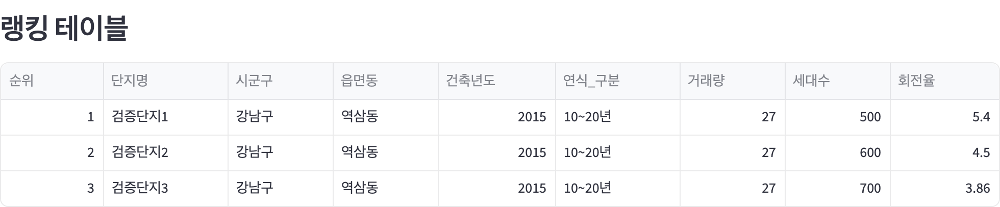

# 8장. 거래량·회전율 지도

[이 장의 프롬프트](../../prompts/part02/chapter08/) · [전체 실행 안내](../../README.md)

## 실행 화면



지도 아래 순위표에서 단지별 거래량, 세대수와 회전율을 함께 확인합니다. 화면은 순위표를 발췌한 것으로, 지도 배경은 포함하지 않습니다.

> 예시 데이터로 구성한 실제 실행 화면입니다. 단지·가격·거래량·지수는 가상 검증 자료이며, 실제 시장 현황을 나타내지 않습니다. [큰 이미지 보기](../../assets/screenshots/chapter08-trade-ranking.png) · [데이터와 촬영 기준](../../assets/screenshots/README.md)

## 필요한 자료와 계산 기준

매매·전월세·공동주택 기본정보와 지역을 포함한 도로명주소별 좌표가 필요합니다. 취소·해제 매매를 제외하고 직거래는 포함합니다. 회전율은 선택 기간 거래량을 단지 전체 세대수로 나눈 값입니다. 좌표나 세대수 연결 실패로 제외된 항목을 구분해 확인하세요.

## 실행

저장소 루트에서 실행합니다. 먼저 `.env`와 3장의 수집 자료를 준비하세요.

```bash
uv run streamlit run projects/chapter08_trade_map/dashboard/app.py
```

`TRADE_MAP_DB_PATH`가 비어 있거나 없으면 기본 `data/apt_investment.duckdb`를 읽습니다. 다른 DB를 사용하려면 해당 파일 경로를 설정합니다. 지정한 DB에 필요한 자료가 없으면 수집 상태와 컬럼을 확인하세요.

지도 배경에는 `VWORLD_API_KEY`가 필요합니다. 키가 없거나 유효하지 않으면 배경 타일이 표시되지 않을 수 있습니다.

## 확인할 것

조회 지역·기간·면적과 거래 건수가 의도한 조건인지 확인하세요. 데이터가 없거나 거래 건수가 적은 경우와 실제 값이 0인 경우를 구분합니다. 화면의 수치는 투자 성과나 미래 가격을 보장하지 않습니다.
